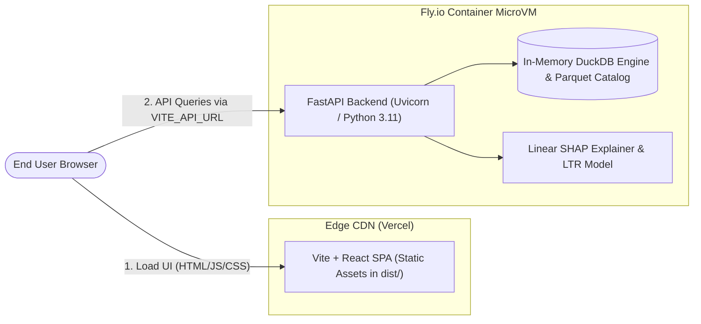

# ExoSignal Production Deployment Guide

This guide provides exact, production-verified instructions for deploying ExoSignal on free-tier-eligible cloud infrastructure:
- **Backend API & Analytical Engine**: Hosted on **Fly.io** (Docker-based container microVM, in-process DuckDB, Linear SHAP explainer).
- **Frontend SPA**: Hosted on **Vercel** (Global edge CDN, Vite React SPA, atomic zero-downtime deploys).

---

## Architecture Overview



- **Zero External Database**: The backend embeds DuckDB in memory, preloading `planets.parquet` and `ltr_model.joblib` at startup. No PostgreSQL, Redis, or managed database is required.
- **Pure Client-Side Routing**: Vercel serves static assets with rewrite rules routing all paths to `/index.html`.
- **CORS Restricted**: Backend rejects API requests from unauthorized origins while permitting the production Vercel frontend.

---

## Configuration Files Matrix

The repository includes pre-configured deployment manifests:

| Target Platform | Component | Manifest File | Description |
|:---|:---|:---|:---|
| **Fly.io** | Backend | [`fly.toml`](file:///a:/Claude%20Code/exosignal/fly.toml) | Fly.io app configuration, ports, resources, and `/ready` healthchecks |
| **Backend Docker** | Backend | [`backend/Dockerfile`](file:///a:/Claude%20Code/exosignal/backend/Dockerfile) | Multi-stage, non-root, pinned Python 3.11 build |
| **Vercel** | Frontend | [`vercel.json`](file:///a:/Claude%20Code/exosignal/vercel.json) | SPA routing rewrites and static asset caching |
| **Render** | Backend (Alt) | [`render.yaml`](file:///a:/Claude%20Code/exosignal/render.yaml) | Render Infrastructure Blueprint |
| **Netlify** | Frontend (Alt) | [`netlify.toml`](file:///a:/Claude%20Code/exosignal/netlify.toml) | Netlify build & redirect rules |

---

## Step 1: Deploy Backend to Fly.io

Fly.io runs Docker containers directly on Firecracker microVMs with fast cold starts and global anycast routing.

### 1. Install Fly CLI & Authenticate

```bash
# macOS / Linux
curl -L https://fly.io/install.sh | sh

# Windows PowerShell
pwsh -Command "iwr https://fly.io/install.ps1 -useb | iex"

# Authenticate
fly auth login
```

### 2. Verify or Update `fly.toml`

The repository includes [`fly.toml`](file:///a:/Claude%20Code/exosignal/fly.toml) configured for `backend/Dockerfile`:

```toml
app = "exosignal-backend"
primary_region = "iad"

[build]
  dockerfile = "backend/Dockerfile"

[env]
  EXOSIGNAL_ENV = "production"
  PORT = "8000"
  ARTIFACT_VERSION = "v1_2026-10-29"
  LOG_LEVEL = "info"
  JSON_LOGS = "true"
  RATE_LIMIT_PER_MINUTE = "120"
  WORKERS = "2"
  CORS_ORIGINS = '["https://*.vercel.app", "http://localhost:3000"]'

[http_service]
  internal_port = 8000
  force_https = true
  auto_stop_machines = "stop"
  auto_start_machines = true
  min_machines_running = 0

[[http_service.checks]]
  grace_period = "15s"
  interval = "30s"
  method = "GET"
  timeout = "5s"
  path = "/ready"

[[vm]]
  memory = "1gb"
  cpu_kind = "shared"
  cpus = 1
```

### 3. Launch and Deploy

From the workspace root directory:

```bash
# Launch app (choose a globally unique app name if exosignal-backend is taken)
fly launch --copy-config --yes

# Deploy the container
fly deploy
```

### 4. Verify Backend Health

Once deployment completes, your service is live at `https://<YOUR_FLY_APP>.fly.dev`. Verify the probes:

```bash
# Liveness Probe
curl -s https://<YOUR_FLY_APP>.fly.dev/health
```
**Actual Response**:
```json
{
  "status": "ok",
  "service": "exosignal",
  "version": "0.3.0",
  "query_engine": "DuckDB Vectorized Parquet Engine",
  "artifact_version": "v1_2026-10-29",
  "catalog_records": 6451,
  "environment": "production"
}
```

```bash
# Readiness Probe (verifies DuckDB query execution on in-memory Parquet table)
curl -s https://<YOUR_FLY_APP>.fly.dev/ready
```
**Actual Response**:
```json
{
  "status": "ready",
  "artifact_version": "v1_2026-10-29",
  "duckdb": "ok",
  "catalog_records": 6451,
  "environment": "production"
}
```

---

## Step 2: Deploy Frontend to Vercel

### Method A: Vercel Web Dashboard (Recommended)

1. Push your repository to GitHub.
2. Log in to [Vercel](https://vercel.com/) and click **Add New...** $\rightarrow$ **Project**.
3. Import your GitHub repository (`exosignal`).
4. Configure the Project Settings:
   - **Framework Preset**: `Vite`
   - **Root Directory**: `frontend`
   - **Build Command**: `npm run build`
   - **Output Directory**: `dist`
5. Expand **Environment Variables** and add:
   - **Key**: `VITE_API_URL`
   - **Value**: `https://<YOUR_FLY_APP>.fly.dev` (your live Fly.io backend URL)
6. Click **Deploy**.
7. Vercel builds the bundle and assigns your production domain (e.g., `https://exosignal.vercel.app`).

### Method B: Vercel CLI

```bash
cd frontend
npm install -g vercel

# Link project
vercel link

# Add backend API URL environment variable for production
vercel env add VITE_API_URL production
# When prompted, enter: https://<YOUR_FLY_APP>.fly.dev

# Deploy to production
vercel --prod
```

---

## Step 3: Configure Backend CORS for the Vercel Domain

To secure the backend and eliminate browser CORS errors, restrict `CORS_ORIGINS` to your exact Vercel production domain:

### Option A: Set via Fly CLI Secret (Zero Downtime)

```bash
fly secrets set CORS_ORIGINS='["https://exosignal.vercel.app", "https://*.vercel.app"]'
```

### Option B: Update `fly.toml` and Re-deploy

In [`fly.toml`](file:///a:/Claude%20Code/exosignal/fly.toml):
```toml
[env]
  CORS_ORIGINS = '["https://exosignal.vercel.app", "https://*.vercel.app"]'
```
Deploy the change:
```bash
fly deploy
```

### Verify CORS Preflight Header

```bash
curl -i -X OPTIONS "https://<YOUR_FLY_APP>.fly.dev/api/v1/top-targets" \
  -H "Origin: https://exosignal.vercel.app" \
  -H "Access-Control-Request-Method: GET"
```

**Expected Response**:
- HTTP 200
- `Access-Control-Allow-Origin: https://exosignal.vercel.app`

---

## Step 4: Run Post-Deploy Smoke Test

Run the automated smoke test script [`scripts/smoke_test.sh`](file:///a:/Claude%20Code/exosignal/scripts/smoke_test.sh) against your live Fly.io deployment. The script executes 5 automated checks and terminates with an exit code of `1` on any non-200 HTTP response:

```bash
chmod +x scripts/smoke_test.sh
./scripts/smoke_test.sh https://<YOUR_FLY_APP>.fly.dev
```

### Checked Endpoints:

1. **Liveness Probe**: `GET /health` (confirms process health and loaded artifact version)
2. **Readiness Probe**: `GET /ready` (confirms DuckDB in-memory execution and nonzero records)
3. **Top Targets Endpoint**: `GET /api/v1/top-targets?limit=5` (confirms ML ranking inference)
4. **Target Detail Endpoint**: `GET /api/v1/planets/TRAPPIST-1%20e` (confirms parameter retrieval)
5. **Linear SHAP Explain Endpoint**: `GET /api/v1/explain/TRAPPIST-1%20e` (confirms analytic feature attributions)

### Successful Output:

```
==================================================================
 Running ExoSignal Post-Deployment Smoke Tests
 Target Base URL: https://exosignal-backend.fly.dev
==================================================================
Testing Liveness Probe (/health)            ... [PASS] (HTTP 200)
Testing Readiness Probe (/ready)            ... [PASS] (HTTP 200)
Testing Top Targets Endpoint (/api/v1/top-targets?limit=5) ... [PASS] (HTTP 200)
Testing Planet Detail Dossier (/api/v1/planets/TRAPPIST-1%20e) ... [PASS] (HTTP 200)
Testing Linear SHAP Explain (/api/v1/explain/TRAPPIST-1%20e) ... [PASS] (HTTP 200)
==================================================================
 [SUCCESS] All 5 production smoke test checks PASSED.
 Deployment is verified healthy and ready to serve traffic.
==================================================================
```

---

## Environment Variables Reference

### Backend (`backend/Dockerfile` / `fly.toml` / `render.yaml`)

| Variable | Required | Default Value | Description |
|:---|:---:|:---:|:---|
| `PORT` | Optional | `8000` | Port for the Uvicorn HTTP server |
| `CORS_ORIGINS` | Recommended | `["*"]` | Allowed frontend origins (JSON array or comma-separated list) |
| `ARTIFACT_VERSION` | Optional | `v1_2026-10-29` | Specific artifact folder in `artifacts/` to serve |
| `EXOSIGNAL_ENV` | Optional | `production` | Operational environment mode (`production`, `development`) |
| `LOG_LEVEL` | Optional | `info` | Logging verbosity (`debug`, `info`, `warning`, `error`) |
| `JSON_LOGS` | Optional | `true` | Structured JSON log output with request ID correlation |
| `RATE_LIMIT_PER_MINUTE` | Optional | `120` | Maximum requests per IP per minute (sliding window) |
| `WORKERS` | Optional | `2` | Number of Uvicorn worker processes |

### Frontend (`frontend/.env` / Vercel Environment Variables)

| Variable | Required | Example | Description |
|:---|:---:|:---|:---|
| `VITE_API_URL` | **Yes** (Vercel) | `https://exosignal-backend.fly.dev` | Public URL of deployed backend. If omitted, frontend falls back to relative `/api/v1` for reverse proxies. |

---

## Performance & Cold-Start Behavior

- **Fly.io Auto-Stop**: With `auto_stop_machines = "stop"`, Fly microVMs suspend when idle to preserve free-tier compute hours. When a user accesses the platform, the machine cold-starts in $< 2.0\text{ seconds}$, initializing the DuckDB table in under 50 ms.
- **In-Memory DuckDB**: Query latency remains $p_{50} \sim 4.6\text{ ms}$, $p_{95} < 10\text{ ms}$ on single-CPU shared instances with 1 GB RAM.
- **Memory Footprint**: The entire catalog ($N=6,451$ planets, 40+ attributes) and Linear SHAP explainer require $\approx 85\text{ MB}$ of memory, well below Fly.io's 1 GB allocation.
