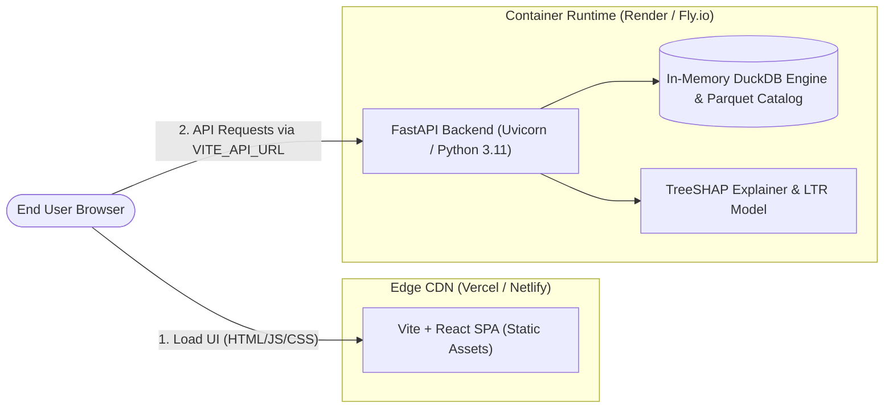

# ExoSignal Production Deployment Guide

This guide provides step-by-step instructions to deploy ExoSignal on modern, free-tier-eligible cloud infrastructure without managing virtual machines.

---

## Architecture Overview

ExoSignal follows a decoupled production architecture:
- **Frontend SPA**: Pre-rendered Vite React application hosted on global edge CDNs (**Vercel** or **Netlify**) with instant atomic deployments and Single-Page Application (SPA) routing rewrites.
- **Backend API & Analytical Engine**: Containerized FastAPI service running in a lightweight Linux container on **Render** or **Fly.io**, executing in-process DuckDB queries and TreeSHAP calculations with zero external database dependencies.



---

## Configuration Files Matrix

The repository includes pre-configured deployment manifests:

| Target Platform | Component | Manifest File | Description |
|:---|:---|:---|:---|
| **Render** | Backend | [`render.yaml`](file:///a:/Claude%20Code/exosignal/render.yaml) | Render Infrastructure-as-Code Blueprint |
| **Fly.io** | Backend | [`fly.toml`](file:///a:/Claude%20Code/exosignal/fly.toml) | Fly.io app configuration and healthchecks |
| **Vercel** | Frontend | [`vercel.json`](file:///a:/Claude%20Code/exosignal/vercel.json) | SPA routing rewrites and asset cache headers |
| **Netlify** | Frontend | [`netlify.toml`](file:///a:/Claude%20Code/exosignal/netlify.toml) | Build commands, SPA redirects, and asset headers |

---

## Environment Variables Reference

### Backend Service

| Variable | Default Value | Description |
|:---|:---:|:---|
| `EXOSIGNAL_ENV` | `production` | Application operational mode |
| `PORT` | `8000` | Port for the Uvicorn HTTP server |
| `LOG_LEVEL` | `info` | Logging verbosity (`debug`, `info`, `warning`, `error`) |
| `JSON_LOGS` | `true` | Structured JSON log output with request ID correlation |
| `RATE_LIMIT_PER_MINUTE`| `120` | Maximum requests per IP per minute (sliding window) |
| `WORKERS` | `2` | Number of Uvicorn worker processes |
| `CORS_ORIGINS` | `["*"]` | Allowed frontend origins (JSON array or comma-separated) |

### Frontend Application

| Variable | Description | Example |
|:---|:---|:---|
| `VITE_API_URL` | Public URL of the deployed backend service | `https://exosignal-backend.onrender.com` |

---

## Deployment Option 1: Backend on Render + Frontend on Vercel

### Step 1: Deploy Backend to Render (Free Tier)

#### Method A: Using Render Blueprints (Recommended)

1. Push your repository to GitHub.
2. Log in to the [Render Dashboard](https://dashboard.render.com/).
3. Click **New +** $\rightarrow$ **Blueprint**.
4. Connect your GitHub repository. Render will automatically detect [`render.yaml`](file:///a:/Claude%20Code/exosignal/render.yaml).
5. Review the plan (`Free`) and click **Apply**.
6. Render builds the Docker image from `backend/Dockerfile` and verifies health via `/ready`.
7. Once deployed, note your service URL: `https://exosignal-backend.onrender.com`.

#### Method B: Manual Web Service Setup

1. In Render Dashboard, click **New +** $\rightarrow$ **Web Service**.
2. Connect your Git repository.
3. Configure the service settings:
   - **Name**: `exosignal-backend`
   - **Language**: `Docker`
   - **Root Directory**: `backend`
   - **Dockerfile Path**: `backend/Dockerfile`
   - **Docker Build Context**: `backend`
   - **Instance Type**: `Free`
4. In **Advanced Settings**, add the **Health Check Path**:
   ```
   /ready
   ```
5. Add the following **Environment Variables**:
   ```env
   EXOSIGNAL_ENV=production
   PORT=8000
   LOG_LEVEL=info
   JSON_LOGS=true
   RATE_LIMIT_PER_MINUTE=120
   WORKERS=2
   CORS_ORIGINS=["https://*.vercel.app", "http://localhost:3000"]
   ```
6. Click **Create Web Service**.

---

### Step 2: Deploy Frontend to Vercel

#### Method A: Vercel Web Dashboard

1. Log in to [Vercel](https://vercel.com/) and click **Add New...** $\rightarrow$ **Project**.
2. Import your GitHub repository.
3. Configure project settings:
   - **Framework Preset**: `Vite`
   - **Root Directory**: Click edit and select `frontend`
   - **Build Command**: `npm run build`
   - **Output Directory**: `dist`
4. Expand **Environment Variables** and add:
   - **Name**: `VITE_API_URL`
   - **Value**: `https://exosignal-backend.onrender.com` (use your actual Render backend URL)
5. Click **Deploy**.
6. Vercel will build and assign a domain (e.g., `https://exosignal.vercel.app`).

#### Method B: Vercel CLI

```bash
cd frontend
npm install -g vercel
vercel
# Link project and set environment variable:
vercel env add VITE_API_URL production
# Deploy to production:
vercel --prod
```

### Step 3: Update CORS on Render

Once you have your production Vercel domain:
1. In Render Dashboard $\rightarrow$ `exosignal-backend` $\rightarrow$ **Environment**.
2. Update `CORS_ORIGINS`:
   ```json
   ["https://exosignal.vercel.app", "https://*.vercel.app"]
   ```
3. Click **Save Changes** (Render will trigger a zero-downtime rolling restart).

---

## Deployment Option 2: Backend on Fly.io + Frontend on Netlify

### Step 1: Deploy Backend to Fly.io (Free Tier)

Fly.io runs Docker containers directly on microVMs with fast cold-starts and global anycast routing.

1. **Install Fly CLI** (if not already installed):
   - **macOS / Linux**: `curl -L https://fly.io/install.sh | sh`
   - **Windows PowerShell**: `pwsh -Command "iwr https://fly.io/install.ps1 -useb | iex"`
2. **Authenticate**:
   ```bash
   fly auth login
   ```
3. **Launch and Deploy from Workspace Root**:
   The repository already includes [`fly.toml`](file:///a:/Claude%20Code/exosignal/fly.toml). Launch with:
   ```bash
   # Launch using existing config
   fly launch --copy-config --yes
   ```
4. **Deploy Application**:
   ```bash
   fly deploy
   ```
5. **Verify Fly Status**:
   ```bash
   fly status
   fly logs
   ```
6. Your backend will be accessible at: `https://exosignal-backend.fly.dev`.

---

### Step 2: Deploy Frontend to Netlify

#### Method A: Netlify Web Dashboard

1. Log in to [Netlify](https://app.netlify.com/) and click **Add new site** $\rightarrow$ **Import an existing project**.
2. Select GitHub and pick the `exosignal` repository.
3. Netlify will detect [`netlify.toml`](file:///a:/Claude%20Code/exosignal/netlify.toml) automatically:
   - **Base directory**: `frontend`
   - **Build command**: `npm run build`
   - **Publish directory**: `dist`
4. Under **Environment variables**, click **Add a variable**:
   - **Key**: `VITE_API_URL`
   - **Value**: `https://exosignal-backend.fly.dev`
5. Click **Deploy exosignal**.

#### Method B: Netlify CLI

```bash
npm install -g netlify-cli
cd frontend
netlify init
netlify env:set VITE_API_URL https://exosignal-backend.fly.dev
netlify deploy --prod --dir=dist
```

---

## Post-Deployment Verification & Smoke Tests

Run these checks against your production deployment:

### 1. Backend Liveness Check

```bash
curl -i https://<YOUR_BACKEND_URL>/health
```
**Expected Response**:
```http
HTTP/2 200
content-type: application/json

{"status":"healthy","model_version":"v1_2026-10-29","duckdb_status":"connected"}
```

### 2. Backend Readiness Check (In-Memory DuckDB Query Validation)

```bash
curl -i https://<YOUR_BACKEND_URL>/ready
```
**Expected Response**:
```http
HTTP/2 200
content-type: application/json

{"status":"ready","database":"duckdb","active_version":"v1_2026-10-29","planet_count":5821}
```

### 3. TreeSHAP Attribution Verification

```bash
curl -i "https://<YOUR_BACKEND_URL>/api/v1/explain/TOI-700%20d"
```
**Expected Response**:
- HTTP 200 with `mathematical_invariants.reconstruction_error < 1e-12`.

### 4. CORS Preflight Check

```bash
curl -i -X OPTIONS "https://<YOUR_BACKEND_URL>/api/v1/planets" \
  -H "Origin: https://<YOUR_FRONTEND_DOMAIN>" \
  -H "Access-Control-Request-Method: GET"
```
**Expected Response**:
- HTTP 200 with header `Access-Control-Allow-Origin: https://<YOUR_FRONTEND_DOMAIN>`.

### 5. Frontend SPA Deep-Link Refresh

Open a direct target detail link in your browser:
```
https://<YOUR_FRONTEND_DOMAIN>/targets/TOI-700%20d
```
Refresh the page. The rewrite rules in `vercel.json` or `netlify.toml` ensure the server serves `/index.html` without returning an HTTP 404 error.

---

## Free-Tier Operation & Cold-Start Considerations

- **Render Free Tier Spin-Down**: Free Render web services spin down after 15 minutes of inactivity. When a request arrives, the service may take 30–50 seconds to warm up. Subsequent requests run at native speed (~3–8 ms DuckDB queries).
- **Fly.io Auto-Stop**: The [`fly.toml`](file:///a:/Claude%20Code/exosignal/fly.toml) configures `auto_stop_machines = "stop"` and `auto_start_machines = true`. Fly microVMs cold-start in < 2 seconds when an incoming request is detected.
- **DuckDB RAM Consumption**: The in-process catalog and LightGBM model consume ~85 MB RAM at runtime, well within the free-tier limits of both Render (512 MB) and Fly.io (1024 MB).

