# ExoSignal

> **Which known exoplanets should JWST observe next for transmission spectroscopy?**

[](https://github.com/Souvik-Mukherjee58/exoplant-project/actions/workflows/ci.yml)
[](https://www.python.org/)
[](https://duckdb.org/)
[](docker-compose.yml)

[Model Card](docs/MODEL_CARD.md) • [Architecture Decisions (ADRs)](docs/adr/) • [Deployment Guide](DEPLOY.md) • [Load Test Report](reports/LOADTEST.md)

_Not deployed yet, and no recording exists yet (`docs/assets/` holds placeholders)._

> **What the scores mean.** ExoSignal is an exploratory ranking of known transiting planets. A priority score is a
> ranking score, not a probability. An anomaly score marks a statistical outlier in the catalog, often caused by unusual
> or uncertain data. Neither is evidence of extraterrestrial life or intelligence.

---

### Headline Results

> **PROVISIONAL (2026-11-22):** every model metric below was computed on 32 labels that have **not** been
> human-verified (0 of 35 rows in `backend/data/reference/jwst_transmission_targets.csv` are `verified=True`;
> see `reports/LABEL_REVIEW.md`). Some of those labels are known to be wrong (e.g. phase-curve or eclipse
> programs). The numbers will be regenerated from human-reviewed labels before they are used anywhere.

- **Nested Cross-Validation AP**: Active Model Ranker achieves $AP = 0.4145$ (empirical 95% interval: $[0.1407, 0.7480]$, $0.4145 \pm 0.2695$) under 5-fold outer `StratifiedGroupKFold` $\times$ 3-fold inner `GroupKFold` cross-validation grouped by host star (`hostname`), completely decoupling model selection from test evaluation.
- **74.6%–90.0% Recall@50**: Recovers $90.0\%$ ($0.9000 \pm 0.1225$) in nested cross-validation and $74.6\%$ ($0.7459 \pm 0.2428$) across 25 host-grouped folds of the planets labelled as JWST targets (labels not human-verified) within the top 50 ranked candidates ($< 1.1\%$ of the catalog), with a median catalog rank of **41.5** in Leave-One-Host-Out cross-validation.
- **Labels**: the served model was trained on 32 **unverified** candidate labels across 4,643 eligible transiting planets. A candidate pipeline (MAST time-series observations compared with transit ephemerides, then human review) is implemented and tested offline only. It currently marks every candidate `ambiguous`, because the archive time systems have not been validated ([ADR 0006](docs/adr/0006-bulk-mast-query-and-ephemeris-matching.md)).
- **Load & Latency ($p\_{95}$ & RPS)**: Concurrent load testing with k6 (ramping to 200 virtual users) reports $p_{95}$ latency: _[Not yet measured]_ (target threshold: $< 150\text{ ms}$), throughput: _[Not yet measured]_ (target threshold: $\ge 100\text{ req/s}$) per [reports/LOADTEST.md](reports/LOADTEST.md).

---

## Architecture

```mermaid
flowchart LR
    A["NASA Archive Ingestion"] --> B["Data Cleaning & Eligibility Rules"]
    B --> C["21 Astrophysical Features"]
    C --> D["JWST Target Labels (not human-verified)"]
    D --> E["Grouped-CV (25 Folds)"]
    E --> F["Model Selection (Linear Ranker)"]
    F --> G["Artifact Registry (SHA256)"]
    G --> H["FastAPI + In-Process DuckDB"]
    H --> I["React + Vite UI (Linear SHAP)"]
```



---

## Data & Eligibility Rules

ExoSignal ingests from the **NASA Exoplanet Archive** composite parameters table (6,451 raw targets) and cross-references candidate JWST target labels (see below):

- **Transit Eligibility**: Strictly transiting planets with valid stellar radius, planetary radius, and host star brightness ($N = 4,643$ eligible candidates).
- **Astrophysical Thresholds**: Evaluates Transmission and Emission Spectroscopy Metrics (TSM/ESM; _Kempton et al. 2018_), with an empirical mass-radius fallback when the archive has no mass. **Known defect:** above 1.23 $R_\oplus$ the code on `main` and the served artifact use $M = 2.69\,R^{0.93}$, which is not the Chen & Kipping (2017) relation it was attributed to, and which underestimates giant-planet masses (so their TSM is too large). A corrected relation exists in unpublished work and must be merged together with a model rebuild.

---

## Label Definition & Biases

- **Ground Truth Positive (target definition, not met by any label yet)**: a planet observed by JWST in transit (transmission spectroscopy), confirmed by a human against the STScI program page, with the transit matched to the observation window by ephemeris (`scripts/build_jwst_labels_from_mast.py`, `scripts/review_labels.py`). The current artifact uses 32 unverified candidates (see the note above).
- **Inherent Biases**: Labels reflect human Telescope Allocation Committee (TAC) proposal approvals rather than raw atmospheric signal ground truth. Targets exhibit observational selection effects: Malmquist bias toward bright infrared host stars ($K < 10$) and large transit depths. Unobserved planets represent unlabeled candidates, not confirmed negatives.

---

## Evaluation Protocol: Grouped CV vs. Temporal Split

1. **Why Host-Grouped Cross-Validation (`StratifiedGroupKFold`)**:
   Multi-planet systems share identical stellar distance, radius, mass, metallicity, and infrared magnitudes. Sibling planets (e.g., TRAPPIST-1 b–h) must remain grouped together. Splitting by host star (`hostname`) across 25 folds prevents leakage between sibling planets. The 95% bootstrap intervals over the 25 repeated folds are approximate, because the folds are not independent; the nested-CV interval is the more honest estimate.
2. **Why Not Temporal Split for Model Selection**:
   Splitting historically (train $\le 2017$, val $2018–2021$, test $\ge 2022$) leaves **exactly one positive target** ($n_{pos} = 1$, LP 791-18 d) in the test split. A single positive candidate makes statistical ranking evaluation unviable ($AP$ oscillates binary-wise with $95\%\text{ CI} = [0, 1]$). Temporal splitting is preserved strictly as a qualitative sanity check ([ADR 0001](docs/adr/0001-grouped-cv-over-temporal-split.md)).

---

## Benchmark Results

_Evaluated over 25 folds (StratifiedGroupKFold, 5 seeds $\times$ 5 folds, grouped by `hostname`). Table dynamically validated via `scripts/render_readme_results.py`._

<!-- prettier-ignore-start -->
<!-- RESULTS:START -->
| Ranker / Model | AP (PR-AUC) [95% CI] | NDCG@25 | Precision@10 | Recall@50 | vs. TSM Baseline |
| :--- | :---: | :---: | :---: | :---: | :--- |
| **Logistic Regression (Variant A - All Features)** | **0.4597** [0.3599, 0.5687] | **0.6017** | **0.3200** | **0.7459** | **+0.2350 (significant)** |
| Logistic Regression (Variant B - Raw Features Only) | 0.3700 [0.2986, 0.4437] | 0.5167 | 0.2920 | 0.7100 | +0.1453 (significant) |
| Model A (LightGBM - All Features) | 0.2673 [0.1950, 0.3539] | 0.3988 | 0.2240 | 0.7634 | +0.0426 (no diff) |
| Distance-Only Baseline | 0.2555 [0.1874, 0.3314] | 0.3701 | 0.2480 | 0.6148 | +0.0308 (no diff) |
| TSM-Only Baseline | 0.2247 [0.1756, 0.2804] | 0.3902 | 0.2240 | 0.5479 | baseline (ref) |
| Heuristic Composite (ExoSignal) | 0.2011 [0.1356, 0.2724] | 0.3559 | 0.1640 | 0.5520 | -0.0236 (no diff) |
| ESM-Only Baseline | 0.1955 [0.1308, 0.2651] | 0.3034 | 0.1600 | 0.4123 | -0.0292 (no diff) |
| Model B (LightGBM - Raw Features Only) | 0.1912 [0.1486, 0.2391] | 0.3243 | 0.1520 | 0.6771 | -0.0335 (no diff) |
| Random Baseline | 0.0104 [0.0079, 0.0138] | 0.0025 | 0.0000 | 0.0702 | -0.2143 (underperformed) |
<!-- RESULTS:END -->
<!-- prettier-ignore-end -->

---

## Lessons Learned

1. **Host-Star Data Leakage in v1**: Initial random train/test splitting partitioned multi-planet systems (e.g., TRAPPIST-1, L 98-59) across splits. Because sibling planets share identical distance, stellar radius, mass, metallicity, and infrared brightness, the model easily memorized stellar properties, artificially inflating AP (reported at the time as $> 0.85$; no log of that run is in the repository). **Fix**: Grouped all splits strictly by host star system (`hostname`) using `StratifiedGroupKFold` across 25 folds ([ADR 0001](docs/adr/0001-grouped-cv-over-temporal-split.md)).
2. **Temporal Split Failure ($n\_{pos} = 1$)**: Attempting an observational temporal split (training on planets discovered $\le 2017$, validating on $2018–2021$, testing on $\ge 2022$) left **exactly one positive target** (LP 791-18 d) in the test split. Evaluation metrics collapsed into binary step functions ($AP \in \{0, 1\}$, $95\%\text{ CI} = [0, 1]$), precluding statistically valid model comparison. **Fix**: Preserved temporal splitting strictly as a forward sanity check, adopting 25-fold grouped cross-validation for model selection and nested cross-validation for honest generalization estimates.
3. **LightGBM / GBDT Overfitting & Tree Collapse**: Gradient-boosted decision trees overfit the small positive label pool ($n = 27–32$). Non-linear split criteria memorized idiosyncratic noise rather than physical trends, failing to outperform the domain baseline (TSM AP: $0.2247$ vs. LightGBM AP: $0.1912–0.2673$, $p > 0.05$). **Fix**: Replaced tree ensembles with regularized logistic regression ($L_2$, $C=1.0$, balanced weights), enforcing monotonic physical relationships and achieving $AP = 0.4597$ ($\Delta = +0.2350$, $p < 0.001$) ([ADR 0002](docs/adr/0002-model-choice.md)).
4. **Unverifiable Program IDs → MAST-Based Manual Verification**: Initial target rosters compiled from secondary literature and press releases contained non-transmission observations (secondary eclipses and emission phase curves like WASP-43 b and WASP-121 b) and 3 incorrect or fabricated program IDs. **Fix**: Replacing hand-curated lists with a Mikulski Archive for Space Telescopes (MAST) query script (`scripts/build_jwst_labels_from_mast.py`) filtering time-series spectroscopy instruments (NIRISS SOSS, NIRSpec BOTS, NIRCam grism, MIRI LRS slitless), followed by human review recorded in `reports/LABEL_REVIEW.md` (no label has been reviewed yet; the script has no recorded live run in this repository) ([ADR 0005](docs/adr/0005-label-verification.md)).

---

## Astrophysical Limitations

- **Small Sample ($n\_{pos} = 32$)**: Bounded by early JWST operational cycles.
- **Human Proxy**: Predicts telescope proposal allocation success, not physical atmospheric composition.
- **Atmospheric Model Absence**: Ranks observational SNR potential; does not model complex cloud decks, hazes, or photochemical equilibrium.

---

## How to Run

### Docker Compose (Recommended)

```bash
git lfs install   # model and catalog files are stored with Git LFS
git clone https://github.com/Souvik-Mukherjee58/exoplant-project.git
cd exoplant-project
docker compose up --build
```

- Frontend: `http://localhost:80` • Backend Swagger: `http://localhost:8000/docs` • Readiness Probe: `http://localhost:8000/ready`

### Artifact Regeneration

```bash
# Regenerate dataset, feature tables, model artifacts, and evaluation reports
cd backend && python -m app.pipeline build
```

### Local Development

```bash
# Backend
cd backend && pip install -r requirements-dev.txt   # Python 3.11
python -m uvicorn app.main:app --reload --port 8000

# Frontend
cd frontend && npm ci && npm run dev   # Node 22.22.2 or later; serves http://localhost:3000
```

---

## Tests & CI Pipeline

```bash
# Run backend test suite + coverage
cd backend && pytest
cd backend && python ../scripts/reproduce_artifact.py   # the served catalog follows from its sources
cd frontend && npm run lint && npm run format:check && npm test

# Run frontend tests
cd frontend && npm test

# Verify README benchmark table freshness
python scripts/render_readme_results.py --check
```

GitHub Actions validates linting (`ruff`), strict type checking (`mypy`), tests, test-pipeline artifact builds, and table freshness on every PR.

---

## Load & Latency Benchmarks

Concurrent load testing with k6 (ramping to 50 then 200 virtual users):

<!-- prettier-ignore-start -->
<!-- LOADTEST:START -->
| Target Concurrency | Throughput (RPS) | Median Latency ($p_{50}$) | 95th Percentile ($p_{95}$) | 99th Percentile ($p_{99}$) | Error Rate |
|:---:|:---:|:---:|:---:|:---:|:---:|
| 200 VUs | *[Not yet measured]* | *[Not yet measured]* | *[Not yet measured]* | *[Not yet measured]* | *[Not yet measured]* |
<!-- LOADTEST:END -->
<!-- prettier-ignore-end -->

_Details & execution instructions: [reports/LOADTEST.md](reports/LOADTEST.md)._

---

## Tech Decisions Summary

| Component               | Choice                   | Rationale                                                                                             |                             ADR                             |
| :---------------------- | :----------------------- | :---------------------------------------------------------------------------------------------------- | :---------------------------------------------------------: |
| **Analytical Engine**   | **DuckDB + Parquet**     | In-process columnar queries, no database network hop, single container. Latency not yet measured.     |      [ADR 0003](docs/adr/0003-duckdb-over-postgres.md)      |
| **Model Architecture**  | **Regularized Logistic** | Monotonic physical scaling, prevents tree overfitting on $n_{pos}=32$, exact closed-form Linear SHAP. |          [ADR 0002](docs/adr/0002-model-choice.md)          |
| **Validation Protocol** | **25-Fold Grouped CV**   | Eliminates multi-planet host star leakage while avoiding $n=1$ temporal test starvation.              | [ADR 0001](docs/adr/0001-grouped-cv-over-temporal-split.md) |
| **UI Reporting**        | **Out-of-Fold Ranks**    | Displays out-of-fold predictions for labelled targets to reduce optimistic reporting bias.            |   [ADR 0004](docs/adr/0004-out-of-fold-scoring-for-ui.md)   |

---

## Contributors

- **Souvik Mukherjee** ([@Souvik-Mukherjee58](https://github.com/Souvik-Mukherjee58)): Full-Stack Architecture, Astrophysical Modeling, ML Ranker & Linear SHAP Pipeline, In-Process DuckDB Analytical Engine, and React UI/UX.

---

## License

The project is intended to be MIT-licensed. The `LICENSE` file has not been added yet, so no license text is in force.
