# ExoSignal

> **Which known exoplanets should JWST observe next for transmission spectroscopy?**

[](https://github.com/Souvik-Mukherjee58/exosignal/actions/workflows/ci.yml)
[](LICENSE)
[](https://www.python.org/)
[](https://duckdb.org/)
[](docker-compose.yml)

[Live Interactive Demo](https://exosignal.vercel.app) • [Model Card](docs/MODEL_CARD.md) • [Architecture Decisions (ADRs)](docs/adr/) • [Deployment Guide](DEPLOY.md) • [Load Test Report](reports/LOADTEST.md)


*30-second walkthrough: candidate explorer, ranking leaderboard, and real-time TreeSHAP waterfall feature attributions.*

---

### Headline Results

- **+104.6% Average Precision Improvement**: Production Ranker achieves $AP = 0.4597$ (95% CI: $[0.3599, 0.5687]$) vs. standard TSM baseline $0.2247$ ($\Delta = +0.2350$, paired bootstrap 95% CI: $[+0.1443, +0.3275]$, $p < 0.001$, $n_{pos} = 32$ confirmed targets among 4,643 eligible planets).
- **74.6% Recall@50**: Recovers $74.59 \pm 24.28\%$ of confirmed JWST atmospheric targets within the top 50 ranked candidates ($< 1.1\%$ of the catalog), with a median catalog rank of **41.5** in Leave-One-Host-Out cross-validation.
- **Zero Group Contamination**: Evaluated across 25 host-grouped folds (`StratifiedGroupKFold`, 5 seeds $\times$ 5 folds) ensuring multi-planet systems (e.g., TRAPPIST-1, L 98-59) never cross train and test splits.

---

## Architecture

```mermaid
flowchart LR
    A["NASA Archive Ingestion"] --> B["Data Cleaning & Eligibility Rules"]
    B --> C["21 Astrophysical Features"]
    C --> D["JWST Ground Truth Labels"]
    D --> E["Grouped-CV (25 Folds)"]
    E --> F["Model Selection (Linear Ranker)"]
    F --> G["Artifact Registry (SHA256)"]
    G --> H["FastAPI + In-Process DuckDB"]
    H --> I["React + Vite UI (TreeSHAP)"]
```



---

## Data & Eligibility Rules

ExoSignal ingests from the **NASA Exoplanet Archive** composite parameters table (6,451 raw targets) and cross-references approved **JWST Cycle 1–3 transmission spectroscopy programs**:
- **Transit Eligibility**: Strictly transiting planets with valid stellar radius, planetary radius, and host star brightness ($N = 4,643$ eligible candidates).
- **Astrophysical Thresholds**: Evaluates Transmission and Emission Spectroscopy Metrics (TSM/ESM; *Kempton et al. 2018*), incorporating *Chen & Kipping (2017)* mass-radius relations when planetary mass measurements are absent.

---

## Label Definition & Biases

- **Ground Truth Positive ($n_{pos} = 32$)**: An exoplanet approved for atmospheric transmission spectroscopy across peer-reviewed JWST Cycle 1–3 General Observer (GO) and Guaranteed Time Observations (GTO) programs.
- **Inherent Biases**: Labels reflect human Telescope Allocation Committee (TAC) proposal approvals rather than raw atmospheric signal ground truth. Targets exhibit observational selection effects: Malmquist bias toward bright infrared host stars ($K < 10$) and large transit depths. Unobserved planets represent unlabeled candidates, not confirmed negatives.

---

## Evaluation Protocol: Grouped CV vs. Temporal Split

1. **Why Host-Grouped Cross-Validation (`StratifiedGroupKFold`)**:
   Multi-planet systems share identical stellar distance, radius, mass, metallicity, and infrared magnitudes. Sibling planets (e.g., TRAPPIST-1 b–h) must remain grouped together. Splitting by host star (`hostname`) across 25 folds prevents catastrophic data leakage and yields narrow, rigorous 95% bootstrap confidence intervals.
2. **Why Not Temporal Split for Model Selection**:
   Splitting historically (train $\le 2017$, val $2018–2021$, test $\ge 2022$) leaves **exactly one positive target** ($n_{pos} = 1$, LP 791-18 d) in the test split. A single positive candidate makes statistical ranking evaluation unviable ($AP$ oscillates binary-wise with $95\%\text{ CI} = [0, 1]$). Temporal splitting is preserved strictly as a qualitative sanity check ([ADR 0001](docs/adr/0001-grouped-cv-over-temporal-split.md)).

---

## Benchmark Results

*Evaluated over 25 folds (StratifiedGroupKFold, 5 seeds $\times$ 5 folds, grouped by `hostname`). Table dynamically validated via `scripts/render_readme_results.py`.*

<!-- RESULTS:START -->
| Ranker / Model | AP (PR-AUC) [95% CI] | NDCG@25 | Precision@10 | Recall@50 | vs. TSM Baseline |
| :--- | :---: | :---: | :---: | :---: | :--- |
| **Logistic Regression (Variant A - All Features)** | **0.4597** [0.3599, 0.5687] | **0.6017** | **0.3200** | **0.7459** | **+0.2350 (significant)** |
| Logistic Regression (Variant B - Raw Features Only) | 0.3700 [0.2986, 0.4437] | 0.5167 | 0.2920 | 0.7100 | +0.1453 (significant) |
| Model A (LightGBM - All Features) | 0.2673 [0.1950, 0.3539] | 0.3988 | 0.2240 | 0.7634 | +0.0426 (no diff) |
| Distance-Only Baseline | 0.2555 [0.1874, 0.3314] | 0.3701 | 0.2480 | 0.6148 | +0.0308 (no diff) |
| TSM-Only Baseline | 0.2247 [0.1756, 0.2804] | 0.3902 | 0.2240 | 0.5479 | baseline (ref) |
| Heuristic Composite (ExoSignal) | 0.2011 [0.1356, 0.2724] | 0.3559 | 0.1640 | 0.5520 | -0.0236 (no diff) |
| ESM-Only Baseline | 0.1955 [0.1308, 0.2651] | 0.3034 | 0.1600 | 0.4123 | -0.0292 (no diff) |
| Model B (LightGBM - Raw Features Only) | 0.1912 [0.1486, 0.2391] | 0.3243 | 0.1520 | 0.6771 | -0.0335 (no diff) |
| Random Baseline | 0.0104 [0.0079, 0.0138] | 0.0025 | 0.0000 | 0.0702 | -0.2143 (underperformed) |
<!-- RESULTS:END -->

---

## What Didn't Work & How It Was Fixed

1. **Random K-Fold Leakage (v1)**: Initial random cross-validation split sibling planets across train and test folds, artificially inflating AP to $> 0.85$. **Fix**: Re-engineered protocol to group strictly on `hostname` (`StratifiedGroupKFold`).
2. **Temporal Split Collapse**: Strict pre/post 2022 temporal splitting starved the test set down to $n_{pos} = 1$, rendering metrics unstable. **Fix**: Retained temporal splitting strictly as a forward sanity check, moving primary model selection to 25-fold grouped CV.
3. **GBDT Overfitting & Tree Collapse**: Complex gradient-boosted decision trees (LightGBM) memorized noise in the 32 positive targets, failing to beat the TSM baseline ($p > 0.05$). **Fix**: Selected regularized linear ranking ($L_2$, balanced weights), enforcing smooth physical monotonicity and boosting AP to 0.4597 ([ADR 0002](docs/adr/0002-model-choice.md)).

---

## Astrophysical Limitations

- **Small Sample ($n_{pos} = 32$)**: Bounded by early JWST operational cycles.
- **Human Proxy**: Predicts telescope proposal allocation success, not physical atmospheric composition.
- **Atmospheric Model Absence**: Ranks observational SNR potential; does not model complex cloud decks, hazes, or photochemical equilibrium.

---

## How to Run

### Docker Compose (Recommended)
```bash
git clone https://github.com/Souvik-Mukherjee58/exosignal.git
cd exosignal
docker compose up --build
```
- Frontend: `http://localhost:80` • Backend Swagger: `http://localhost:8000/docs` • Readiness Probe: `http://localhost:8000/ready`

### Local Development
```bash
# Backend
cd backend && pip install -r requirements.txt
python -m uvicorn app.main:app --reload --port 8000

# Frontend
cd frontend && npm install && npm run dev
```

---

## Tests & CI Pipeline

```bash
# Run 158 backend tests + coverage
cd backend && pytest

# Run frontend tests
cd frontend && npm test

# Verify README benchmark table freshness
python scripts/render_readme_results.py --check
```
GitHub Actions validates linting (`ruff`), strict type checking (`mypy`), tests, test-pipeline artifact builds, and table freshness on every PR.

---

## Tech Decisions Summary

| Component | Choice | Rationale | ADR |
|:---|:---|:---|:---:|
| **Analytical Engine** | **DuckDB + Parquet** | In-process columnar queries ($p_{50} \sim 3.6\text{ ms}$, $p_{95} < 8\text{ ms}$), zero network hops, single container. | [ADR 0003](docs/adr/0003-duckdb-over-postgres.md) |
| **Model Architecture** | **Regularized Logistic** | Monotonic physical scaling, prevents tree overfitting on $n_{pos}=32$, exact closed-form TreeSHAP. | [ADR 0002](docs/adr/0002-model-choice.md) |
| **Validation Protocol** | **25-Fold Grouped CV** | Eliminates multi-planet host star leakage while avoiding $n=1$ temporal test starvation. | [ADR 0001](docs/adr/0001-grouped-cv-over-temporal-split.md) |
| **UI Reporting** | **Out-of-Fold Ranks** | Displays unbiased out-of-fold predictions for known targets to prevent optimistic reporting bias. | [ADR 0004](docs/adr/0004-out-of-fold-scoring-for-ui.md) |

---

## Contributors

- **Souvik Mukherjee** ([@Souvik-Mukherjee58](https://github.com/Souvik-Mukherjee58)): Full-Stack Architecture, Astrophysical Modeling, ML Ranker & TreeSHAP Pipeline, In-Process DuckDB Analytical Engine, and React UI/UX.

---

## License

This project is licensed under the MIT License — see the [LICENSE](LICENSE) file for details.
